<!-- ═══════════════════════════════════════════════════════════════════════
     DH R U V   P U R I  ·  BUILDER'S CASE FILE
     Keep case-board.svg in the repository's assets/ directory.
     ═══════════════════════════════════════════════════════════════════ -->

  

 

<h1 align="left">Hey, I'm Dhruv Puri </h1>

### AI/ML Student · Builder · Curious by default

I like turning interesting ideas into useful software. I'm exploring **machine learning, LLM applications, RAG systems, and backend engineering** — mostly by building things, breaking them, and figuring out how to make them better.

 

---

## `01` / A little about me

- 🎓 B.Tech CSE student, specializing in **Artificial Intelligence**.
- 🧠 Interested in **ML, LLMs, hybrid retrieval, agentic systems, and software architecture**.
- 🛠️ I enjoy building end-to-end projects — from the first rough prototype to the underlying systems.
- 🌱 Currently learning more about **RAG evaluation, MLOps, DSA, and system design**.
- 🤝 Open to collaborating on practical AI/ML and open-source projects.

> `build()` → `learn()` → `experiment()` → `ship()` → `repeat()`

## `02` / Featured builds

<table>
  <tr>
    <td width="33%" valign="top">
      <h3>🧠 Knowmon</h3>
      ENTERPRISE KNOWLEDGE · HYBRID RAG
      
A learning-first enterprise knowledge platform designed to make internal information retrievable, explainable, and grounded in source citations.

      
<code>Python</code> <code>RAG</code> <code>Dense + lexical search</code> <code>Reranking</code>

    </td>
    <td width="33%" valign="top">
      <h3>🤖 Deox</h3>
      PERSONAL AI · DESKTOP ASSISTANT
      
A personal AI assistant experiment exploring conversational memory, local models, vision, voice, and desktop interaction.

      
<code>Python</code> <code>Ollama</code> <code>LLMs</code> <code>Tool use</code>

    </td>
    <td width="33%" valign="top">
      <h3>🩸 Raktara</h3>
      HEALTHCARE · REAL-TIME PLATFORM
      
A blood-donation platform concept connecting donors, hospitals, and requests through location-aware matching and real-time workflows.

      
<code>React</code> <code>Node.js</code> <code>PostgreSQL</code> <code>Prisma</code> <code>Redis</code>

    </td>
  </tr>
</table>

## `03` / Tech stack

  

**AI / Data:** Machine Learning · PyTorch · scikit-learn · XGBoost · Pandas · NumPy · MLflow · LLMs · RAG · Embeddings · Vector Search

**Engineering:** Python · JavaScript · TypeScript · React · Node.js · Express · SQL · PostgreSQL · MongoDB · Redis · REST APIs · Docker · Git · Linux

Technologies reflect a mix of hands-on project work and ongoing learning.

## `04` / GitHub activity

  
  

  

---

### ✦ Keep building. Keep being curious. ✦

*“Every dataset has a story — I just help it speak.”*

[GitHub](https://github.com/Dhruvg0) · [LinkedIn](https://www.linkedin.com/in/dhruv-purii/) · [Email](mailto:dhruvpurigoswami2004@gmail.com)

